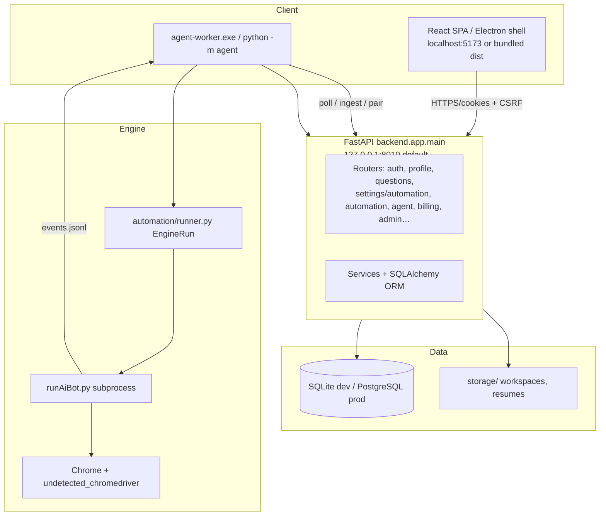

# ApplyXAI — End-to-End Technical Audit (Master Report)

**Audit date:** 2026-10-16  
**Repository:** `C:\xampp\htdocs\applyxainew`  
**Phase completed:** Phase 0 (baseline & discovery) + partial Phases 1–7 (read-only + test execution)  
**Method:** Source inspection, router/model inventory, automated test runs (no live LinkedIn submissions, no production data changes)

This document is the **single entry point** for the audit. Detailed supplements live alongside it (see [§12 Deliverables](#12-deliverables)).

---

## 1. Executive summary

ApplyXAI is a **hybrid product**: a mature **desktop LinkedIn automation engine** (`runAiBot.py`, `modules/`, `config/`) wrapped by a **multi-user SaaS** (FastAPI + React + SQLite/PostgreSQL + desktop agent/Electron). The SaaS stack is **substantially implemented**—auth, profiles, custom questions, automation settings, applications, billing hooks, admin, institute/partner portals—not a greenfield proposal.

| Area | Status | Evidence |
|------|--------|----------|
| Classic control panel | **Operational** (legacy) | `app.py` → subprocess `runAiBot.py`, `user_config.json` |
| SaaS API | **Operational** (dev/prod-capable) | `backend/app/main.py`, 22 API modules, Alembic (33 revisions) |
| Web app | **Operational** | `frontend/` React routes under `/app/*`, admin, institute, partner |
| Desktop product | **Operational** | `desktop/` Electron, `agent-worker.exe`, `dist/ApplyXAI-Desktop-Setup.exe` |
| Automation bridge | **Operational** | `automation/runner.py` → subprocess engine + `events.jsonl` ingest |
| Multi-user isolation | **Tested** | `backend/tests/test_isolation.py` and related API tests |
| Production SaaS | **Not fully verified** | Production gates in config; Razorpay/Redis/PostgreSQL required at runtime |
| Full E2E (browser UI) | **Partial** | Backend-heavy tests; Vitest for pages; Playwright smokes in `frontend/e2e` (gated on `E2E_EMAIL`) |

**Verdict:** Suitable for **controlled multi-user beta** on the current architecture if production checklist items (payments, Redis rate limits, PostgreSQL, backups, security sign-off) are completed. **Not** “audit-complete” for unrestricted public launch without closing P0/P1 items in [AUDIT_FINDINGS.md](./AUDIT_FINDINGS.md).

---

## 2. Architecture snapshot (current)

### 2.1 Entry points

| Entry | Command / artifact | Role |
|-------|------------------|------|
| SaaS API | `.\scripts\dev_api.ps1` or `uvicorn backend.app.main:app --reload --port 8010` | REST API, auth, persistence |
| Web UI | `npm run dev` in `frontend/` | Primary product UI |
| Classic panel | `venv\Scripts\python app.py` | Legacy local control panel (:5000) |
| Engine (direct) | `python runAiBot.py` | Single-run automation |
| Agent (CLI) | `python -m agent run` / `pair` | Polls API, runs engine in workspace |
| Desktop | `dist/ApplyXAI-Desktop-Setup.exe` | Electron + bundled UI + worker |
| Build desktop | `.\scripts\build_desktop.ps1` | Frontend + PyInstaller worker + NSIS |

**Note:** Local API default port is **8010** (see `.env.example`, `scripts/dev_api.ps1`), not 8000. Master audit prompts referencing 8000 are **documentation drift** only.

### 2.2 Automation execution path (authoritative)

1. User starts run in UI → `POST /api/automation/...` (see [API_INVENTORY.md](./API_INVENTORY.md)).
2. `AutomationService` assigns run to paired **device**; agent **polls** with heartbeats (`active_run_id`).
3. Agent invokes `automation.runner.EngineRun` → subprocess **`runAiBot.py`** with `APPLYXAI_RUN_CONFIG` JSON overlay.
4. Engine emits **`events.jsonl`** (applied / failed / skipped); agent **ingests** to API → applications + notifications.
5. **Single-engine lock** (`automation/engine_lock.py`) limits concurrent Chrome on one PC.

Legacy Flask `app.py` path remains for solo developers; SaaS does **not** import `runAiBot` in-process.

---

## 3. Frontend routes (verified)

Source: `frontend/src/App.tsx` (2026-10-16).

| Route | Purpose |
|-------|---------|
| `/app` | Dashboard |
| `/app/profile` | Master profile |
| `/app/questions` | Custom screening questions |
| `/app/settings/automation` | Automation execution settings (separate from profile) |
| `/app/automation/search` | Job search preferences |
| `/app/automation`, `/app/automation/connect` | Runs + desktop connect |
| `/app/applications`, `/app/jobs` | Tracking + catalogue |
| `/app/resumes`, `/app/billing`, `/app/settings`, `/app/notifications` | Core SaaS |
| `/admin/*`, `/institute/*`, `/partner/*` | Role-specific consoles |

`/app/preferences` redirects to `/app/questions` (search prefs remain under profile/preferences API).

---

## 4. Profile, questions, and automation settings (Phase 4)

| Concern | Backend | Frontend | Separation |
|---------|---------|----------|--------------|
| **Profile** | `GET/PUT /api/profile`, sections, photo, taxonomies | `/app/profile` | Master profile service |
| **Screening Q&A** | `GET/PUT/PATCH/DELETE /api/questions` | `/app/questions` | `custom_questions_service` |
| **Default engine answers** | `/api/preferences/application`, `/api/preferences/search` | Search prefs page + engine overlay | `preferences_service` + `engine_fields` |
| **Automation runtime** | `GET/PATCH /api/settings/automation` | `/app/settings/automation` | `automation_settings_service` |

**Finding:** Boundaries exist in API and UI; users must still understand that **LinkedIn Easy Apply** also reads `config/questions.py` defaults via run config merge—documented in [AUTOMATION_AUDIT.md](./AUTOMATION_AUDIT.md).

---

## 5. Security and isolation (Phase 5 & 9)

Implemented controls are documented in [SECURITY.md](./SECURITY.md) (Argon2id, JWT + refresh rotation, CSRF, CORS allow-list, production startup guards).

**Verified by tests (sample):**

- `backend/tests/test_isolation.py` — cross-user resumes, profile, preferences, applications, jobs, dashboard stats.
- `backend/tests/test_security.py`, `test_auth_api.py`, `test_two_factor_api.py`.
- `backend/tests/test_razorpay_util.py` — signature verification helpers.

**Residual risks:** See [SECURITY_AUDIT.md](./SECURITY_AUDIT.md) and prioritized [AUDIT_FINDINGS.md](./AUDIT_FINDINGS.md).

---

## 6. Database (Phase 6 summary)

- **ORM models:** 23 files under `backend/app/models/` (users, applications, jobs, automation runs, subscriptions, resumes, mock/live interviews, institute/partner, etc.).
- **Migrations:** 33 Alembic versions under `backend/alembic/versions/` (latest include `master_profile`, `run_kind`, `job_sources`).
- **Local:** SQLite `storage/applyxai.db` when `DATABASE_URL` empty.
- **Production:** PostgreSQL required when `APP_ENV=production`.

Details: [DATABASE_AUDIT.md](./DATABASE_AUDIT.md).

---

## 7. Automation integrity (Phase 7 summary)

- **Production engine:** `runAiBot.py` (~2.3k+ lines) + `modules/*` (not duplicated in backend).
- **Recent reliability work:** Easy Apply modal/footer selectors (`modules/clickers_and_finders.py`), Chrome update helper (`modules/chrome_update.py`), engine session lock, agent poll re-delivery, desktop single-worker port 39217.
- **Safety:** `stop_before_submit`, practice/dry-run paths, attestation checkboxes not auto-ticked in engine logic.
- **Tests:** `tests/test_selectors_groundtruth.py`, `tests/test_runaibot_fixes.py`, `tests/test_automation_runner.py`, `backend/tests/test_automation_api.py`, `test_ingest.py`.

Details: [AUTOMATION_AUDIT.md](./AUTOMATION_AUDIT.md).

---

## 8. Billing and SaaS (Phases 8 & 10)

- Razorpay integration paths in `backend/app/api/billing.py` + `test_billing_api.py`, `test_razorpay_util.py`.
- `PAYMENT_PROVIDER=null` allowed in development; **production refuses start** without real provider (see `.env.example`).
- Plans, usage, subscriptions: models + admin UI; entitlement enforcement must remain **server-side** (partially covered by tests—see BACKLOG).

Roadmap alignment: [SAAS_ROADMAP.md](./SAAS_ROADMAP.md) (historical) + live tracker [BACKLOG.md](./BACKLOG.md).

---

## 9. Test baseline (Phase 13 — executed 2026-10-16)

| Suite | Command | Result |
|-------|---------|--------|
| Backend API | `venv\Scripts\python.exe -m pytest backend\tests -m "not live"` | **397 passed**, **2 failed**, **1 skipped** (~176s) |
| Backend + engine | `pytest backend\tests tests -m "not live"` | **707 passed**, **44 failed**, **1 skipped** (~31 min) |
| Engine (sample) | `pytest tests/test_runaibot_fixes.py tests/test_selectors_groundtruth.py tests/test_automation_runner.py` | **50 passed**, **1 failed** |

**Failures (confirmed):**

1. `backend/tests/test_tailored_resume_limits.py` — async tests without `pytest-asyncio` (`async def functions are not natively supported`).
2. `tests/test_runaibot_fixes.py::test_text_question_is_typed_through_human_type` — regression in question typing path.

**Skipped:** PostgreSQL migration parity unless `TEST_POSTGRES_URL` set.

**Limitation:** Collecting/running the **full** root `tests/` suite can be slow or appear hung when imports pull automation modules; run by file or use CI partitioning.

Full report: [TESTING_REPORT.md](./TESTING_REPORT.md).

---

## 10. Production readiness (Phase 15 — assessment)

| Criterion | Status |
|-----------|--------|
| Secret management (.env, not committed) | **Implemented** |
| PostgreSQL + migrations | **Implemented**; PG parity test optional |
| Redis for rate limits / Celery | **Configured**; must be enabled in prod |
| Razorpay live + webhooks | **Partial** (see BACKLOG #32) |
| Desktop installer | **Built** (`ApplyXAI-Desktop-Setup.exe`) |
| Security sign-off | **Partial** (template exists) |
| CI green on all tests | **No** (2+ failures above) |

Details: [PRODUCTION_READINESS.md](./PRODUCTION_READINESS.md).

---

## 11. Prioritized findings (summary)

Full register: [AUDIT_FINDINGS.md](./AUDIT_FINDINGS.md).

| ID | Sev | Title |
|----|-----|-------|
| AUD-001 | P2 | Async resume limit tests fail — missing `pytest-asyncio` |
| AUD-002 | P2 | `test_text_question_is_typed_through_human_type` failing |
| AUD-003 | P2 | Full root `tests/` run reliability / import-time side effects |
| AUD-004 | P1 | Production launch blockers in BACKLOG (Razorpay, Redis rate limit, sign-off) |
| AUD-005 | P3 | Docs reference port 8000; project standard is **8010** |
| AUD-006 | P3 | Dual Python envs: `venv/` (SaaS) vs `.venv/` (`start.bat`) |
| AUD-007 | P2 | Easy Apply failures on live LinkedIn — selector/UI drift (ongoing maintenance) |

---

## 12. Deliverables

| Document | Description |
|----------|-------------|
| **AUDIT.md** (this file) | Master audit report |
| [ARCHITECTURE_AUDIT.md](./ARCHITECTURE_AUDIT.md) | Historical + updated architecture notes |
| [AUDIT_FINDINGS.md](./AUDIT_FINDINGS.md) | Finding register with remediation status |
| [TESTING_REPORT.md](./TESTING_REPORT.md) | Commands, results, gaps |
| [SECURITY_AUDIT.md](./SECURITY_AUDIT.md) | Security review supplement |
| [API_INVENTORY.md](./API_INVENTORY.md) | Router and endpoint map |
| [DATABASE_AUDIT.md](./DATABASE_AUDIT.md) | Schema and migration notes |
| [AUTOMATION_AUDIT.md](./AUTOMATION_AUDIT.md) | Engine and agent flows |
| [WINDOWS_SETUP.md](./WINDOWS_SETUP.md) | Verified Windows dev startup |
| [PRODUCTION_READINESS.md](./PRODUCTION_READINESS.md) | Launch checklist |
| [SAAS_ROADMAP.md](./SAAS_ROADMAP.md) | Historical roadmap (see BACKLOG for current) |

---

## 13. Recommended next implementation steps

1. **Fix AUD-001 / AUD-002** — add `pytest-asyncio` to dev requirements; repair human_type question test.
2. **Re-run full backend suite** — target 400/400 green; enable `TEST_POSTGRES_URL` in CI.
3. **Close BACKLOG P0** — Razorpay production, Redis rate limits, backup automation, security sign-off.
4. **Partition engine tests** — avoid import-time Chrome in collection; document in TESTING_REPORT.
5. **Continue Easy Apply selector maintenance** — fixture-driven tests in `tests/fixtures/06_easy_apply_modal.html`.

---

## 14. Acceptance criteria (this audit pass)

| Criterion | Met? |
|-----------|------|
| Repository inspected | Yes |
| Baseline tests executed with recorded results | Yes (backend full; engine sample) |
| Architecture and flows documented | Yes |
| Existing engine preserved | Yes (wrapper-only SaaS integration) |
| All defects fixed | **No** — findings recorded; fixes deferred per incremental rule |
| Live LinkedIn E2E during audit | **No** (by design) |

**Auditor note:** This pass **does not** claim production launch approval. It establishes an evidence-based baseline and a controlled remediation backlog.
